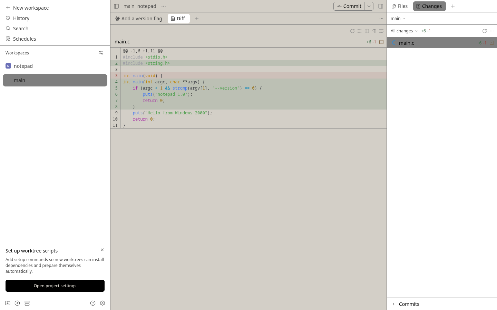

# Windows 2000 theme for Paseo

A [Paseo](https://paseo.sh) theme that paints the app in the Windows 2000 "Windows Standard" color scheme, using the exact registry defaults rather than approximations.




## Install

```bash
paseo plugin add git:maci0/paseo-win2k-theme
```

Then pick **Windows 2000** under Settings → Appearance → Theme. Requires Paseo 0.15.3 or later.

## Colors

Every value comes from the `HKCU\Control Panel\Colors` defaults, as recorded in [win2k.css](https://github.com/maci0/zine/blob/a17c2d1e9f056876f2bef186dfc03aca25a74cd6/src/gui/win2k.css#L106-L148).

| Paseo color       | Value     | Windows 2000 color |
| ----------------- | --------- | ------------------ |
| `background`      | `#d4d0c8` | ButtonFace         |
| `foreground`      | `#000000` | WindowText         |
| `raised`          | `#ffffff` | Window             |
| `control`         | `#ffffff` | Window             |
| `border`          | `#808080` | ButtonShadow       |
| `accent`          | `#0a246a` | Hilight            |
| `mutedForeground` | `#404040` | ButtonDkShadow     |
| `ring`            | `#808080` | GrayText           |

## Limits

Paseo's `addTheme` takes eight colors and derives the rest, so:

- Fonts, corner radii, and spacing stay Paseo's. No bevels, title bar gradients, or pixel cursors.
- Text on the accent is `background` (#d4d0c8), not HighlightText white.
- Sidebar hover uses `border` and sidebar selection uses `ring`; both are #808080, so they look the same.
- Secondary text uses ButtonDkShadow (#404040), not GrayText (#808080): GrayText on ButtonFace is 2.6:1, too faint to read.

## Development

```bash
bun install
bun run typecheck
paseo plugin install "$PWD"
paseo plugin reload win2k-theme
```

Changes are logged in [docs/provenance.md](docs/provenance.md).
