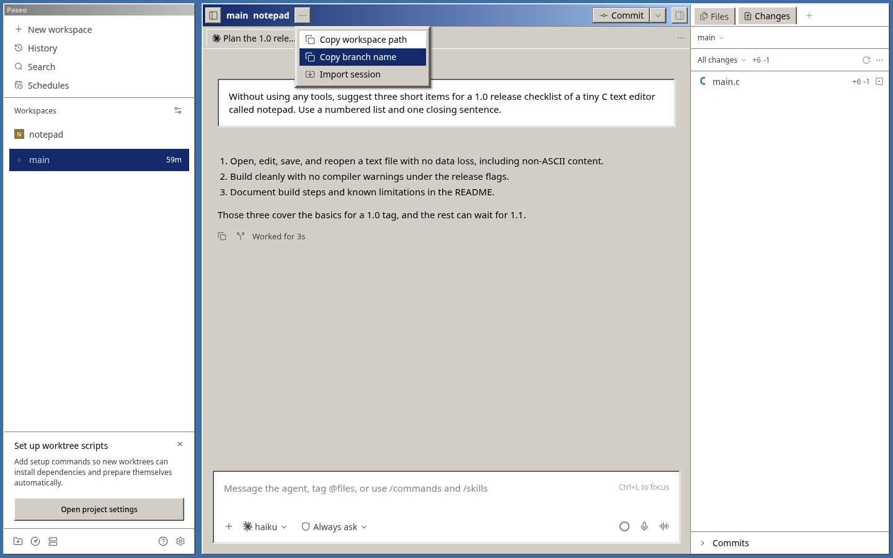
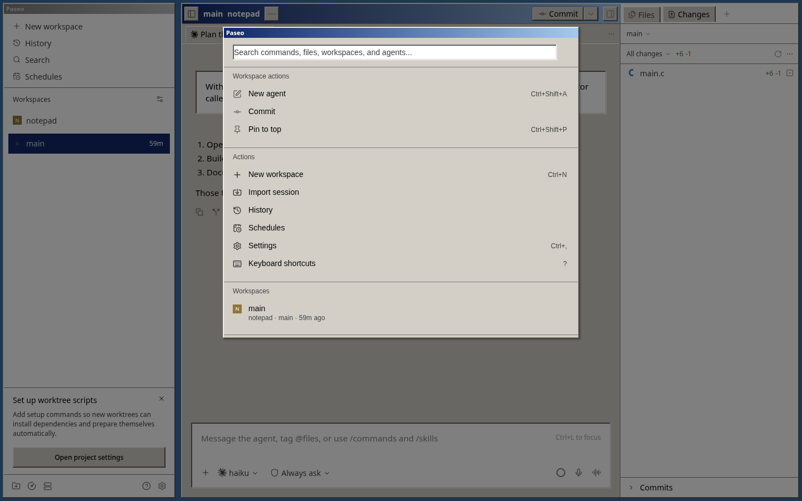

# Windows 2000 theme for Paseo

A [Paseo](https://paseo.sh) theme that makes the app look like Windows 2000: desktop blue behind raised windows, gradient title bars, 3D bevels, and the exact "Windows Standard" colors.





## Install

```bash
paseo plugin add maci0/win2k-theme
```

Then pick **Windows 2000** under Settings → Appearance → Theme. Requires Paseo 0.15.3 or later.

## What it changes

On desktop and web:

- The sidebar and workspace are raised windows on the `#3a6ea5` desktop.
- Title bars use the active caption gradient (`#0a246a` → `#a6caf0`), and go grey when the sidebar has focus. Dialogs get a caption bar too.
- Push buttons, caption buttons, tabs, menus and dialogs get the two-tone 3D bevel. Toolbar buttons raise a 1px bevel on hover.
- Text fields, the composer and your prompts are sunken white wells.
- Selected rows, menu items and text selection are Highlight navy with white text.
- 16px scrollbars with arrow buttons on the dithered track, the arrow, hand and I-beam cursors, square corners, and Tahoma where installed.

The iOS and Android apps get the colors only.

## Colors

Every value comes from the `HKCU\Control Panel\Colors` defaults, as recorded in [win2k.css](https://github.com/maci0/zine/blob/a17c2d1e9f056876f2bef186dfc03aca25a74cd6/src/gui/win2k.css#L106-L148). The chrome's edge model, scrollbars, cursors and menu colors follow [clanker's win2k.css](https://github.com/maci0/clanker/blob/main/themes/win2k.css).

| Paseo color       | Value     | Windows 2000 color |
| ----------------- | --------- | ------------------ |
| `background`      | `#d4d0c8` | ButtonFace         |
| `foreground`      | `#000000` | WindowText         |
| `raised`          | `#ffffff` | Window             |
| `control`         | `#ffffff` | Window             |
| `border`          | `#808080` | ButtonShadow       |
| `accent`          | `#0a246a` | Hilight            |
| `mutedForeground` | `#404040` | ButtonDkShadow     |
| `ring`            | `#808080` | GrayText           |

## How it works

`addTheme` takes those eight colors. On web and desktop the client entry also adds a stylesheet ([client/chrome.ts](client/chrome.ts)). Every rule sits inside a CSS style query on the theme's own color variables, so it applies only while this theme is selected and switching themes removes it without a reload. The same query overrides the shades Paseo derives badly for this palette: text on the accent is white, sidebar hover is button face and selection is navy.

CSS cannot select on computed styles, so [client/web.ts](client/web.ts) watches the DOM and marks two things: `<button>`s Paseo draws with a border (push buttons), and the opaque panel inside each `role="dialog"`. It does nothing while another theme is selected.

## Limits

- The chrome hooks into Paseo's `data-testid` names and ARIA roles. Built and tested against the Paseo 0.15.3 web UI in Chromium; a Paseo update that renames those can drop parts of it until this plugin follows.
- The chrome needs CSS style queries on custom properties. The desktop app's Chromium has them; a browser without them gets the colors only.
- Interface text uses Tahoma when installed, which overrides the interface font setting while the theme is selected.
- Secondary text uses ButtonDkShadow (`#404040`), not GrayText (`#808080`): GrayText on ButtonFace is 2.6:1, too faint to read.
- Dialogs have no title to show, so their caption bar reads "Paseo".

## Development

```bash
bun install
bun run typecheck
paseo plugin install "$PWD"
paseo plugin reload win2k-theme
```

Changes are logged in [docs/provenance.md](docs/provenance.md).
